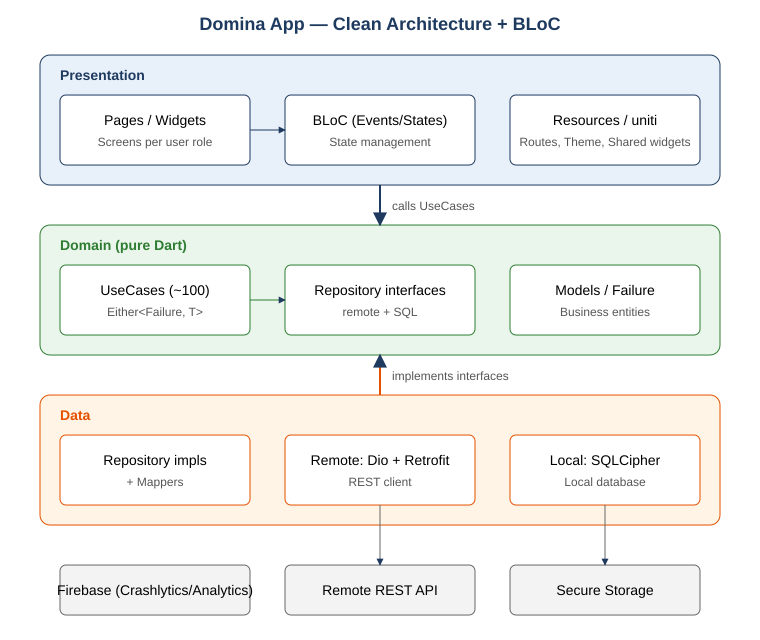
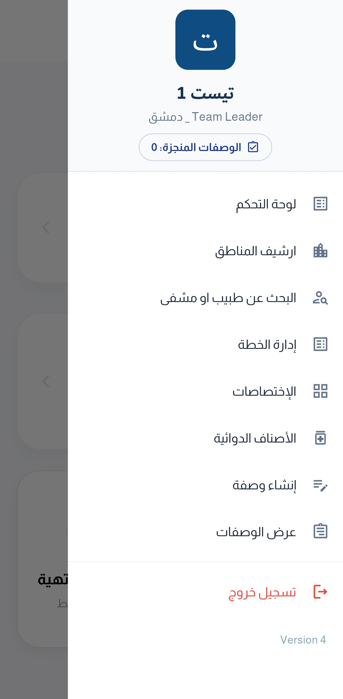
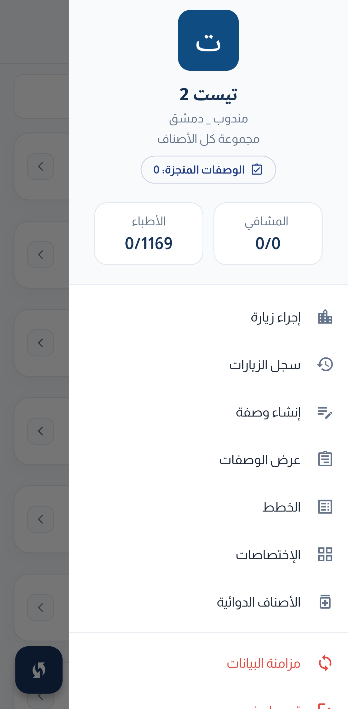
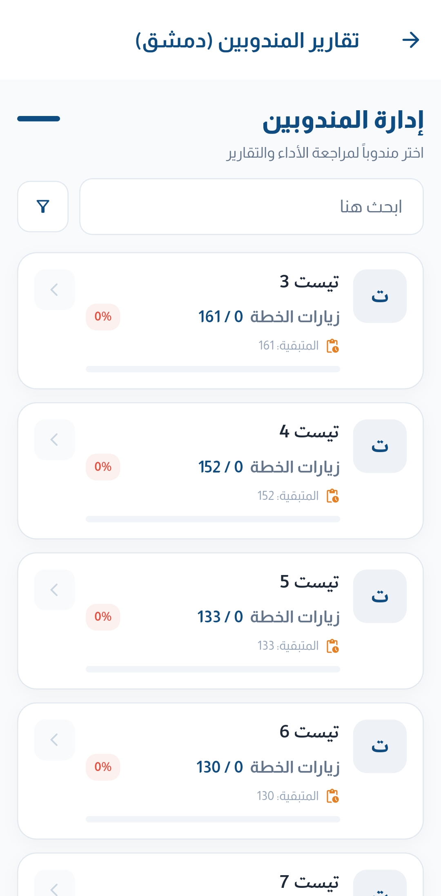
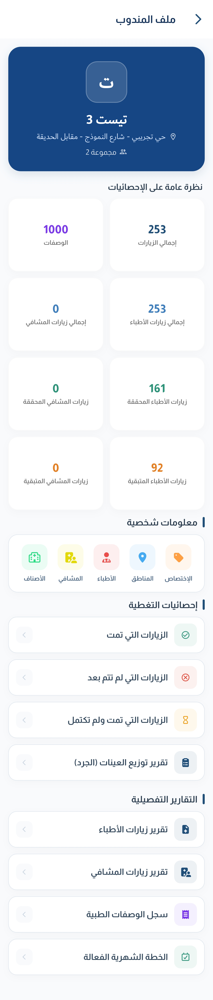
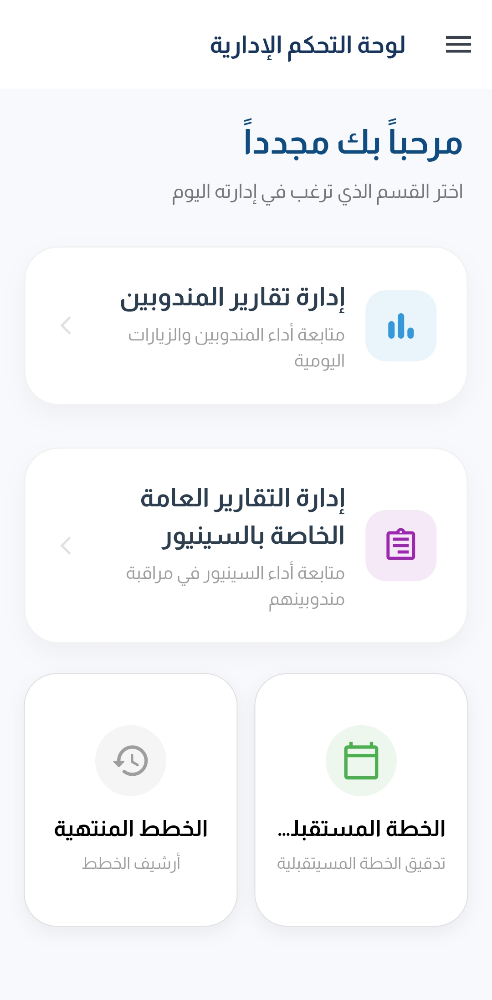

# 💊 Domina App

**تطبيق Flutter لإدارة المندوبين الطبيين ميدانياً.**


## ✨ ماذا يفعل؟

يساعد المندوب على تنظيم زياراته للأطباء والمستشفيات والصيدليات ومتابعة خطته، ويمنح المشرفين أدوات للمتابعة والتقارير.

| 👨‍⚕️ المندوب | 📊 الإشراف والإدارة |
|---|---|
| أدلّة الأطباء والمستشفيات والصيدليات | تقارير الزيارات |
| تسجيل الزيارات | إدارة ومراجعة الخطط |
| متابعة خطة المنتجات | تقرير المخزون |
| الوصفات | البحث وملفات المندوبين |
| إشعارات وتنبيهات | لوحة إدارة |

## 🌟 أبرز النقاط

- **Offline-First:** يعمل ميدانياً حتى مع ضعف الاتصال.
- **بيانات محلية مشفّرة.**
- **Clean Architecture** مع اختبارات آلية تحافظ على حدود الطبقات.
- **مراقبة الأخطاء والاستخدام** عبر Firebase.
- **ثنائي اللغة:** عربي (RTL) وإنجليزي.

## 🏗️ المعمارية



```
Page ──event──▶ BLoC ──▶ UseCase ──▶ Repository ──▶ Remote / Local
Page ◀──state── BLoC ◀── Either<Failure, T>
```

## 🧰 التقنيات

| الفئة | الأدوات |
|---|---|
| الحالة والـ DI | `flutter_bloc`, `get_it`, `dartz`, `freezed` |
| الشبكة | `dio`, `retrofit` |
| التخزين | SQLite مشفّرة، `flutter_secure_storage` |
| الواجهة | `flutter_screenutil`, `easy_localization`, `lottie`, `shimmer` |
| الخدمات | Firebase، إشعارات محلية |
| CI/CD | Codemagic |

## 🚀 التشغيل

```bash
flutter pub get
flutter pub run build_runner build --delete-conflicting-outputs
flutter run
```

## 📸 لقطات الشاشة

| قائمة قائد الفريق | قائمة المندوب |
|:---:|:---:|
|  |  |

| قائمة المندوبين | ملف المندوب | لقطة إضافية |
|:---:|:---:|:---:|
|  |  |  |
